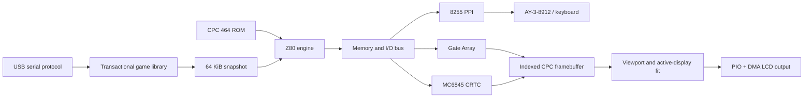

<div align="center">

# CPC Explorer

### A portable Amstrad CPC 464 for the Pimoroni Explorer RP2350

[](https://www.raspberrypi.com/products/rp2350/)
[](#emulated-hardware)
[](CMakeLists.txt)
[](docs/STAGE4F6_SRAM_Z80_EXPERIMENT.md)
[](#verification)
[](LICENSE)

**Real CPC ROM execution · fast Z80 engine · native 320×240 display · persistent USB game library**

</div>

CPC Explorer turns the Pimoroni Explorer RP2350 into a self-contained Amstrad
CPC 464. It boots the original CPC ROM, runs Locomotive BASIC, restores 64 KiB
snapshots, drives the Explorer LCD through PIO and DMA, and stores additional
games in a transactional on-device library.

The project includes both a cycle-stepped reference emulator and a faster,
instruction-oriented engine. The reference remains available for deterministic
comparison while the fast engine provides the practical hardware path.

> [!IMPORTANT]
> CPC ROMs and game data are not distributed in this repository. You must
> supply media that you are legally entitled to use.

## Highlights

- Authentic CPC 464 OS and Locomotive BASIC ROM execution.
- Z80, Gate Array, MC6845 CRTC, 8255 PPI, AY-3-8912 register state and keyboard matrix emulation.
- Reference and fast Z80 execution engines with cycle-accounted peripherals.
- 320×240 Explorer display output using PIO, DMA and bounded scanline buffers.
- Active-display fitting for games while preserving CPC proportions.
- Native launcher with scrolling, debounce and X/Z/Y button control.
- Persistent 16 MiB flash library for standalone CPC464 64 KiB snapshots.
- Transactional upload, CRC validation, dual catalogs and interruption recovery.
- Confirmed single-game removal without erasing unrelated games.
- Protected firmware, catalog, payload and RP2350-E10 flash regions.
- Windows packaging, inspection, detection, upload and removal tools.
- USB performance telemetry for physical CPC-speed measurements.

## Current hardware status

The current physically tested baseline is `0.4.10-stage4f6sramstep`.

| Area | Status |
|---|---|
| Locomotive BASIC | Boots and accepts repeated commands |
| Knight Tyme | Loads and runs from a verified snapshot |
| Manic Miner | Loads, uses full-screen active-display fit and accepts gameplay input |
| Persistent library | Upload, reboot persistence and transactional removal verified |
| USB protocol | Detect, status, list, upload and remove verified |
| Flash identity | Winbond EF-40-18, 16 MiB |
| E10 protection | Final 64 KiB permanently excluded from game storage |
| Host regression suite | 11/11 passing |

Measured on the Explorer at 150 MHz with Manic Miner:

| Metric | Stage 4F.6 result |
|---|---:|
| Effective CPC speed | 74.18% |
| Z80 execution per 20 ms CPC slice | 23.00 ms |
| Total loop work | 26.94 ms |
| Display mode | Active-display fit enabled |

These are physical measurements, not desktop benchmark projections. The
reference and fast-engine investigation history is documented under [`docs/`](docs/).

## Controls

### Launcher

| Explorer button | Action |
|---|---|
| X | Up |
| Z | Down |
| Y | Select / launch |

### Gameplay profiles

Profiles translate held, active-low Explorer buttons into held CPC keyboard
matrix states. Launch-button suppression prevents the Y press used to select a
game from leaking into gameplay.

| Game/profile | X | Z | Y |
|---|---|---|---|
| Manic Miner | Q / left | W / right | bare Shift / jump |
| Dizzy, host-verified profile | Z / left | X / right | Space / start and jump |

The Dizzy profile and package are host-verified development work; physical
acceptance requires a separately built and approved firmware deployment.

## Architecture



### Emulated hardware

- Z80 CPU with 64 KiB RAM.
- Lower and upper ROM overlays with ROM switching.
- Amstrad Gate Array mode, palette and interrupt state.
- MC6845 display timing and raster reconstruction.
- 8255 PPI and AY keyboard scanning.
- Snapshot restoration of CPU, memory and peripheral state.

Disk and tape images are not mounted by the production firmware. DSK, CDT and
loose BASIC/BIN games must first be loaded through a verified host recipe and
captured as a standalone CPC464 snapshot.

## Flash layout

The library is deliberately separated from application firmware:

| Flash offset | Size | Purpose |
|---|---:|---|
| `0x000000–0x3FFFFF` | 4 MiB | Firmware reservation; uploader cannot write here |
| `0x400000–0x403FFF` | 16 KiB | CPCLIB1 catalog A |
| `0x404000–0x407FFF` | 16 KiB | CPCLIB1 catalog B |
| `0x408000–0xFEFFFF` | 12,484,608 bytes | 4 KiB-aligned snapshot allocations |
| `0xFF0000–0xFFFFFF` | 64 KiB | Permanent RP2350-E10 guard |

Each installed snapshot consumes 69,632 bytes after sector alignment. The
current layout can hold at most 179 snapshot allocations and 192 catalog
descriptors. Removed payloads are intentionally not reclaimed yet, preventing
an older valid catalog from referencing overwritten storage.

## Repository layout

```text
cmake/                 RP2350 board/build support
docs/                  Hardware, format, safety and stage reports
licenses/              Upstream licence texts
prototypes/            Isolated architecture and performance experiments
src/                    Emulator, launcher, display and flash-library code
tests/                  Host regression and fault-injection tests
third_party/chips/      Pinned chips-based reference emulator components
tools/                  Importer, uploader, validators and snapshot tooling
```

Generated firmware, ROMs, snapshots, game packages, backups, build directories
and framebuffer captures are intentionally ignored by Git.

## Prerequisites

- Windows 10 or 11.
- CMake 3.20 or newer.
- Ninja.
- Python 3.
- Visual Studio C++ Build Tools for the host reference suite.
- Pico SDK 2.2.0 and an Arm GNU toolchain for RP2350 firmware.
- A legally obtained 32 KiB English CPC 464 ROM.

Place the ROM at `roms/cpc464.rom`. The expected SHA-256 is:

```text
00960d9bf75b2b90856c970f1aa078e1e2aa028b2c104f1dded0262f5d37b15e
```

The ROM remains ignored. See [ROM provenance and policy](docs/ROM_PROVENANCE.md).

Some game-specific regression tests also require the corresponding locally
owned source files. Their paths can be supplied through the CMake cache rather
than committed to the repository.

## Host build and verification

Run from a Visual Studio Developer PowerShell or Developer Command Prompt:

```powershell
cmake -S . -B build-host -G Ninja -DCMAKE_BUILD_TYPE=Release
cmake --build build-host
ctest --test-dir build-host --output-on-failure
```

The suite covers ROM boot, BASIC keyboard input, Knight Tyme, snapshot loading,
launcher behavior, library parsing, transactional upload/removal, corruption
and interruption recovery, importer validation, UF2/E10 policy, gameplay input,
display fitting and performance telemetry.

## Build the Stage 4F.6 firmware

Set `PICO_SDK_PATH`, provide the ignored ROM and Knight Tyme snapshot, then run:

```powershell
cmake -S . -B build-rp2350-stage4f6-sram-step -G Ninja `
  -DCMAKE_BUILD_TYPE=Release `
  -DCPCEXPLORER_BUILD_FIRMWARE=ON `
  -DPICO_BOARD=pimoroni_explorer `
  -DCPCEXPLORER_STARTUP=LIBRARY_FAST `
  -DCPCEXPLORER_ENABLE_FAST_ENGINE=ON `
  -DCPCEXPLORER_DEFAULT_ENGINE=FAST `
  -DCPCEXPLORER_STAGE4F6_SRAM_STEP=ON `
  -DCPCEXPLORER_FAST_PRESENTATION_DIVISOR=4

cmake --build build-rp2350-stage4f6-sram-step
```

Post-link checks reject firmware outside the 4 MiB reservation and verify that
only the intended Z80 step routine is relocated to SRAM with the required heap,
stack and memory headroom. UF2 validation also permits only the precisely
recognised SDK-generated RP2350-E10 compatibility block.

## Game packaging and USB library

Install pyserial once:

```powershell
py -m pip install pyserial
```

Validate and package a standalone CPC464 snapshot:

```powershell
py tools/cpc_game.py import-sna game.sna `
  --id game_id `
  --title "Game Title" `
  --output game.cpcgame

py tools/cpc_game.py inspect game.cpcgame
```

Read-only device queries:

```powershell
py tools/cpc_game.py detect
py tools/cpc_game.py status
py tools/cpc_game.py list
```

Explicitly confirmed mutations:

```powershell
py tools/cpc_game.py upload game.cpcgame --port COM11 --confirm UPLOAD
py tools/cpc_game.py remove game_id --port COM11 --confirm REMOVE
```

The port number is not stable; use `detect` rather than assuming COM11. Uploads
are accepted only while the launcher is active. A package is published only
after transport CRC, package CRC, complete payload CRC, flash readback and
inactive-catalog verification all succeed.

Supported package input is intentionally narrow:

- `MV - SNA` snapshot signature.
- SNA version 1, 2 or 3.
- Exactly 64 KiB RAM and 65,792 total snapshot bytes.
- CPC464 machine identity for v2/v3 snapshots.
- No live disk, tape or 128 KiB dependency.

## Flashing safety

1. Preserve a known-good rollback UF2 and any MicroPython filesystem backup.
2. Recalculate and record the candidate SHA-256.
3. Validate every UF2 target before touching hardware.
4. Enter BOOTSEL manually and confirm RP2350 VID/PID, volume label and `INFO_UF2.TXT`.
5. Copy the approved UF2 exactly once. Never perform a separate full-chip erase.
6. If the result is ambiguous, stop and inspect the device read-only; do not automatically retry.

See [Stage 4B USB installation](docs/STAGE4B_USB_INSTALL.md) and
[Stage 4F.6 SRAM experiment](docs/STAGE4F6_SRAM_Z80_EXPERIMENT.md) for the
full safety model and verified build measurements.

## Verification

The repository includes fault-injection tests for interrupted payload writes,
catalog erases, catalog programming, final activation, removal recovery,
generation selection, duplicate IDs, CRC failures, overflow boundaries and
protected-region overlap.

The current host tree passes all 11 configured tests. Fast-engine integration
has separate deterministic comparisons against the reference engine for BASIC,
Knight Tyme and Manic Miner.

## Documentation

- [Hardware and pin assignments](docs/HARDWARE.md)
- [Memory report](docs/MEMORY_REPORT.md)
- [ROM provenance](docs/ROM_PROVENANCE.md)
- [USB installation and flash safety](docs/STAGE4B_USB_INSTALL.md)
- [Transactional game removal](docs/STAGE4B1_SAFE_REMOVAL.md)
- [Fast-engine production integration](docs/STAGE4E1_FAST_INTEGRATION.md)
- [Stage 4F.6 SRAM Z80 experiment](docs/STAGE4F6_SRAM_Z80_EXPERIMENT.md)
- [Arcade collection assessment](docs/STAGE4G1_ARCADE_EXPANSION.md)
- [Generic controls and Chuckie Egg feasibility](docs/STAGE4G2_GENERIC_CONTROLS_CHUCKIE.md)

## Licensing

CPC Explorer is distributed under the [GNU General Public License v3](LICENSE).

Third-party components retain their own licences:

- [`floooh/chips`](licenses/chips-LICENSE.txt) — zlib/libpng licence.
- RP2350 display/board work derived from RP2350-Quake — [GPLv3 notice](licenses/RP2350-Quake-GPL-3.0.txt).
- Fast Z80 core integration — [MIT licence](third_party/licenses/cpu-z80-MIT.txt).

Amstrad, Locomotive BASIC and individual game names belong to their respective
owners. No ROM or commercial game content is included.
